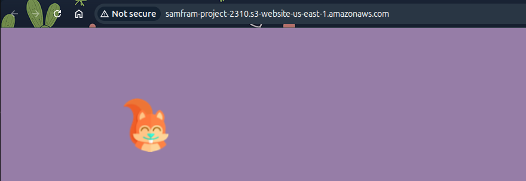
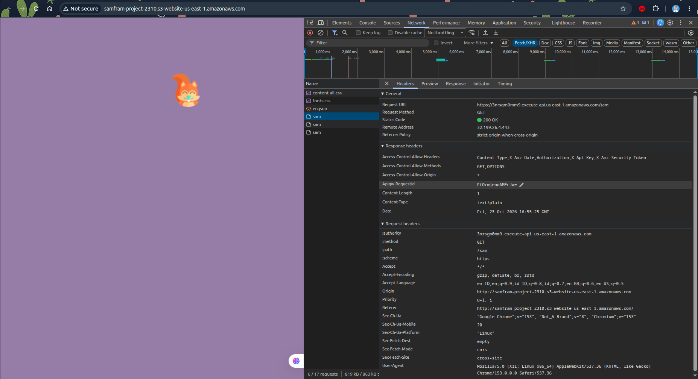

## CONFIGURE S3
1. create bucket > general purpose > give bucket name. uncheck Block all public access > create bucket
2. upload file app.js index.html squirrel.png
3. on tab permission make sure that block public access is iff, and edit bucket policy like this
```
{
    "Version": "2012-10-17",
    "Statement": [
        {
            "Sid": "PublicReadWebsiteFiles",
            "Effect": "Allow",
            "Principal": "*",
            "Action": "s3:GetObject",
            "Resource": "arn:aws:s3:::samfram-project-2310/*" --> modify with ur S3 arn
        }
    ]
}
```
4. on tab properties edit the static web hosting, set enable. index document is index.html > save. access the bucket website endpoint


## CONFIGURE LAMBDA
1. Create event function > author from scratch > give function name > runtime nodejs > additional setting > custom execution role is labrole > create
2. add file index.js and package.json to the lambda vscode > deploy
3. on cloudshell
```
mkdir -p ~/samfarm-api
cd ~/samfarm-api
curl -fL https://raw.githubusercontent.com/aws-samples/aws-serverless-samfarm/master/api/index.js -o index.js
curl -fL https://raw.githubusercontent.com/aws-samples/aws-serverless-samfarm/master/api/package.json -o package.json
cat package.json
npm install --omit=dev
zip -r function.zip index.js package.json node_modules
aws lambda update-function-code \
  --function-name samfram-api \
  --zip-file fileb://function.zip \
  --region us-east-1
```
4. on tab test > create new event > give name > event json default > test

## CONFIGURE API GATEWAY
1. create api > HTTP API > give api name > integrations : lambda 
2. route : get | path: sam > stage default > create

## REPLACE GET_SAM_COUNT_URL AT APP.JS
```
var GET_SAM_COUNT_URL = 'https://3nrsgm0mm9.execute-api.us-east-1.amazonaws.com/sam';
```
invoke_url/sam
